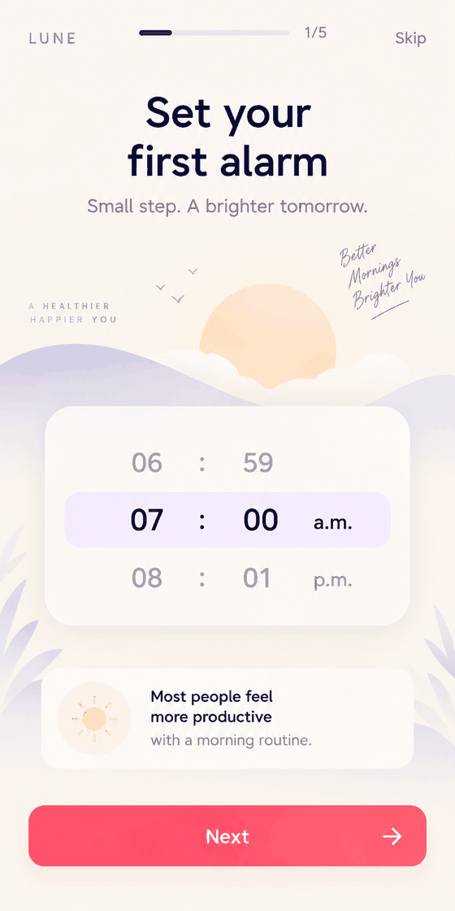

# ⏰ Uthja (Lune) — Gen Z Anti-Snooze Alarm (Android)

Live: uthja.meenai.in

A Gen Z-focused alarm app that actually gets you out of bed. Dismiss the alarm by completing challenges — shake your phone, solve math problems, type a sentence, or find color tiles — and build a morning routine you actually keep.

## How it works



| Set your first alarm | Choose a wake-up mission | Own your morning |
|---|---|---|
|  |  |  |

## Features

- 🧠 Wake-up missions: Math (solve questions), Find Color Tiles, Typing (type the given sentence), Shake (shake the phone), or plain Off
- 🌅 Alarm wallpapers — trending, aesthetic, nature, minimal and anime styles, so mornings look different
- 🎵 Alarm vibes — pick the sound that gets you up (trending, calm, nature, focus, fun)
- 😴 Sleep tracking and wake-up insights
- 🔔 Reliability setup that walks you through notifications, display-over-apps and battery permissions so the alarm rings
- 📊 Intentional morning routines, streaks and habit tracking
- 🌙 Calm, minimal, night-friendly design

## Tech Stack

- Kotlin (native Android) with Jetpack Compose
- Room for local storage, WorkManager/AlarmManager for exact alarms
- Firebase (optional; builds without a google-services.json with a warning)

## Build

Open the project in Android Studio and run on an emulator or device, or:

```sh
gradle :app:assembleRelease   # or :app:assembleDebug
```

## License

MIT
